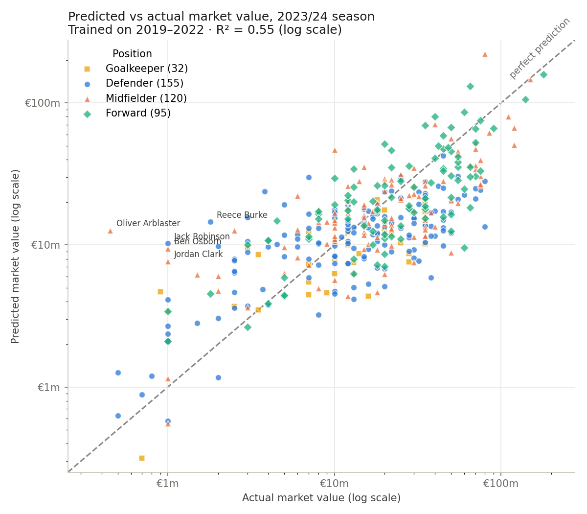

# Premier League Transfer Value Predictor

Search any Premier League player from 2019/20 to 2023/24 and see what a model thinks they're worth next to their real market value, or enter your own stats to see what you'd be worth.

**[Try the app →]([https://YOUR-APP.streamlit.app](https://transfervaluepredictor.streamlit.app/ ))**

The model is a linear regression on six inputs: goals, assists, minutes, age, position and club strength. It was trained on four seasons and tested on a fifth it never saw. On that unseen season it explains **78%** of the variation in (log) market value, against 5% for a naive baseline.



## Results

Trained on 2019/20–2022/23 (1,591 player-seasons), tested on 2023/24 (400 player-seasons). Only players with 450+ minutes count.

| Model | R² (log scale) | Mean abs. error | Median % error | Within 50% of actual |
|---|---|---|---|---|
| Baseline: median value for the player's position | 0.05 | €16.4m | 60% | 42% |
| v1: stats only | 0.55 | €12.1m | 46% | 55% |
| **v2: stats + club points** | **0.78** | **€8.2m** | **32%** | **75%** |

### v1 found the missing feature

The stats-only model's biggest misses were all about club. Its most overvalued list (actual far above predicted) was four Manchester City players and one from Manchester United. Its most undervalued list came entirely from Sheffield United and Luton, the two promoted clubs that finished bottom. With only minutes and goals to go on, it couldn't tell a Luton regular from a City regular.

### v2 added club strength

v2 adds each club's league points that season. That one feature lifted R² from 0.55 to 0.78 and became the strongest predictor, at about **+57% value per standard deviation**. The goals effect fell from +30% to +15%, because part of what had looked like a goals effect was really strong clubs scoring more.

- **Manchester City:** John Stones went from the model's biggest miss to 32nd of 400. Rúben Dias's prediction rose from €13.4m to €41.9m.
- **Promoted clubs:** they still fill the undervalued end (11 of the bottom 20 are Sheffield United or Luton), but the misses shrank. Oliver Arblaster went from predicted at 25× his value to 12×. A straight-line points effect can't fully capture how little a relegated squad's players are worth in the market.

### What's still wrong: availability

v2's most overvalued players are mostly stars who missed much of the season: Ivan Toney (banned until January 2024), and Lisandro Martínez, Aaron Hickey and Kevin De Bruyne (long injuries). The top 20 overvalued played a median of 1,293 minutes, against 1,727 overall. The market prices ability, not one season's availability, and this model can't tell an injured star from a fringe player.

Two smaller effects:

- **Potential.** Players aged 21 or under are underrated more than average. In 2020 the market priced Bukayo Saka at €65m on 5 goals, against the model's €26m. The model caught up as his output grew.
- **Market drift.** Predictions run slightly low overall, probably because market values rose over the period and a model trained on earlier seasons can't anticipate that.

## How it works

```
Understat (stats) ───────────┐
Transfermarkt (values) ──────┼─► merge_data.py ─► train_model.py ─► app.py / predict.py
football-data.co.uk (points) ┘    name matching     regression        search + "what are you worth?"
```

### 1. Data collection, and what broke

Getting clean historical data took more work than the model did.

| Source | Attempt | Problem | Fix |
|---|---|---|---|
| football-data.org | Original plan | Free tier has no assists, minutes or market values | Dropped |
| FBref (stats) | `requests` + BeautifulSoup | Cloudflare JS challenge: HTTP 403 on every request, even with `cloudscraper` and TLS impersonation | Switched to Understat |
| Understat (stats) | Parse `playersData` JSON embedded in the page | The site moved player data out of the HTML | Found the internal AJAX endpoint (`/getLeagueData/EPL/{season}`) in browser dev tools and called it directly |
| Transfermarkt (values) | Global "most valuable players" ranking | Ignores its `saison_id` parameter, so every "season" returned today's values; also only ~100 unique players | Scraped each club's squad page per season instead (20 clubs × 5 seasons) |
| Transfermarkt (values) | Value parser | Site switched to `€35.00M`; parser expected lowercase `m`, so €35m was saved as 35 | Case-insensitive parsing, full re-scrape |
| Understat (team points) | Planned source for club strength | Site unreachable for days | Computed league tables from football-data.co.uk's results CSVs |

**Checking the values are really historical:** Erling Haaland first appears in 2022, when he joined Manchester City. Of the 255 players present in both 2019 and 2023, only 0.8% have the same value. **Checking the league tables:** Liverpool top in 2019 with 99 points, Manchester City top in every other season (91 in 2023). Points come from scores only, so Everton's and Forest's 2023 deductions aren't included, which suits a measure of on-pitch strength.

### 2. Matching players across sources

The two sites spell names differently (Martin Ødegaard / Martin Odegaard, Son Heung-Min / Heung-min Son, Kepa / Kepa Arrizabalaga), so `merge_data.py`:

1. Normalizes names (lowercase, accents and letters like `ø` stripped).
2. Fuzzy-scores every pair within a season with `rapidfuzz`.
3. Penalizes position disagreement. A goalkeeper can't match an outfielder, which stopped Liverpool's keeper Adrián matching a 19-year-old City midfielder with the same first name.
4. Assigns matches one-to-one, best score first.
5. Applies manual overrides for names too different to fuzzy-match (Max Kilman / Maximilian Kilman, Franck Zambo / Frank Anguissa).
6. Holds out players it can't tell apart: Understat lists both Emerson Royal and Emerson Palmieri as "Emerson", so those rows are excluded rather than risk a swap.

Every uncertain match is written to `match_review.csv`, and I checked them by hand. **Match rate among regulars (900+ minutes): 99.4–100% per season.**

### 3. Modeling choices

- **Test on an unseen season, not a random split.** A random split puts the same player in both train and test (as different seasons), which inflates the score.
- **Log-transformed target.** Values are heavily skewed, and the log makes effects proportional ("+57% value") rather than flat euro amounts.
- **Age curve.** `(age − 25)²` lets a linear model capture value rising and then falling with age.
- **Club points, not squad value.** A club's total squad value would leak the very market values being predicted. League points measure strength without that leak.
- **Baseline comparison.** An R² means little on its own, so every version is scored against a position-median guess on the same rows.

## Run it

```bash
pip install -r requirements.txt

# Optional: rebuild the data (the repo already includes the processed files)
python src/fetch_understat_stats.py          # stats, 5 seasons
python src/scrape_transfermarkt.py --test    # check one club first
python src/scrape_transfermarkt.py           # values, ~100 pages, ~5 min
python src/fetch_team_points.py              # league tables
python src/merge_data.py                     # match players across sources
python src/train_model.py                    # train, evaluate, plot

# Use it
streamlit run app.py                         # web app
python src/predict.py --player "Saka"        # or from the terminal
```

Player lookups use a model refit on all five seasons, so they show how the model reads a player rather than a test score. Out-of-sample predictions are in `outputs/predictions_2023.csv` after running `train_model.py`.

## Project structure

```
app.py                       Streamlit web app
src/
  fetch_understat_stats.py   stats from Understat's JSON endpoint
  scrape_transfermarkt.py    market values from club squad pages
  fetch_team_points.py       league tables from football-data.co.uk
  merge_data.py              cross-source name matching
  train_model.py             features, regression, evaluation, chart
  predict.py                 command-line lookup
data/
  processed/merged.csv       the matched dataset the app uses
  processed/manual_overrides.csv
  raw/team_points_*.csv      league points per club and season
```

## Limitations and next steps

- **Add availability.** The previous season's minutes would let the model tell an injured star from a fringe player. That's the clearest remaining pattern in its errors.
- **Model relegation directly.** A "bottom three" flag, or a curve in club points, could capture the extra drop in value at relegated clubs.
- **Account for market drift**, for example with a season trend term.
- **Market value isn't a transfer fee.** Transfermarkt values are crowd-sourced estimates. They're the right target here, since most players aren't transferred in a given season, but they're not prices anyone paid.
- **Stats are basic by design.** Goals and assists undersell defenders and keepers. Understat also provides xG and xA, a natural extension.
